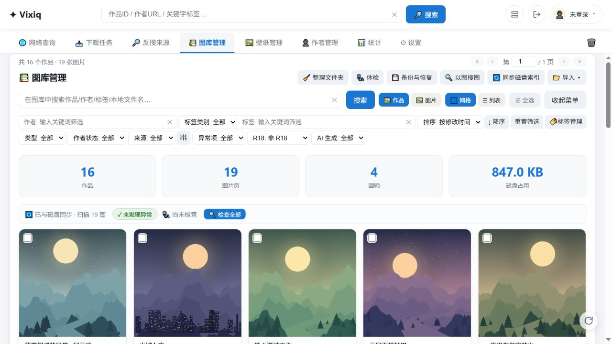
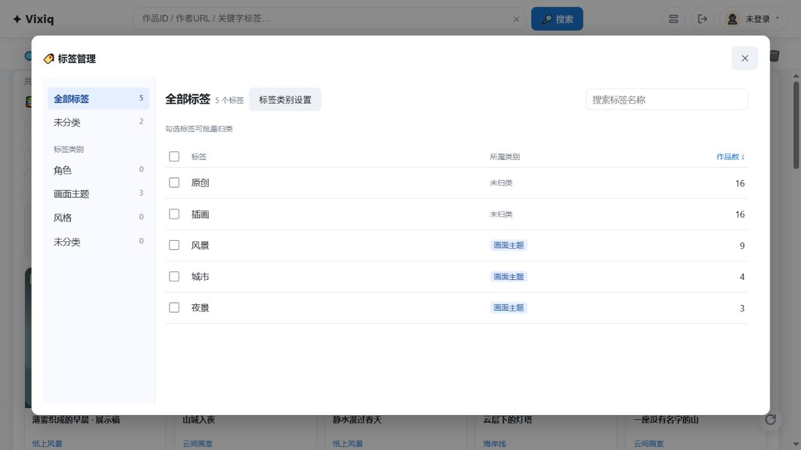
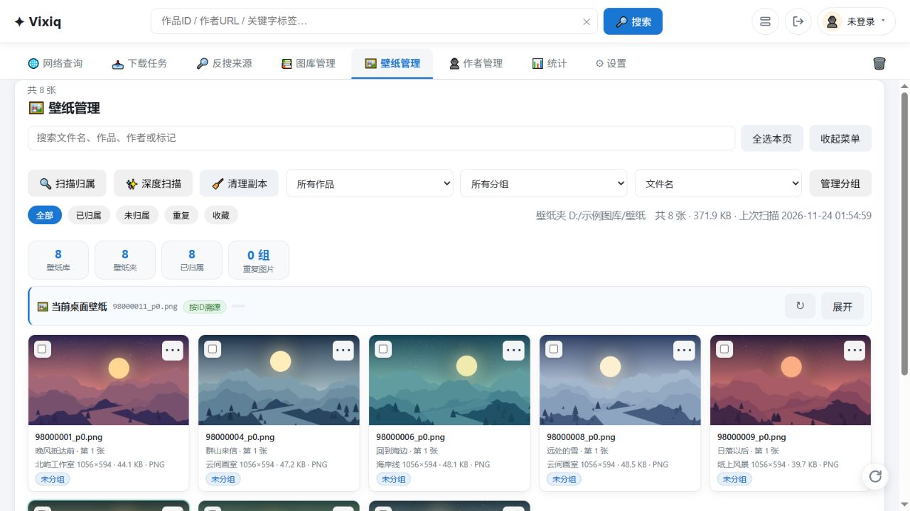
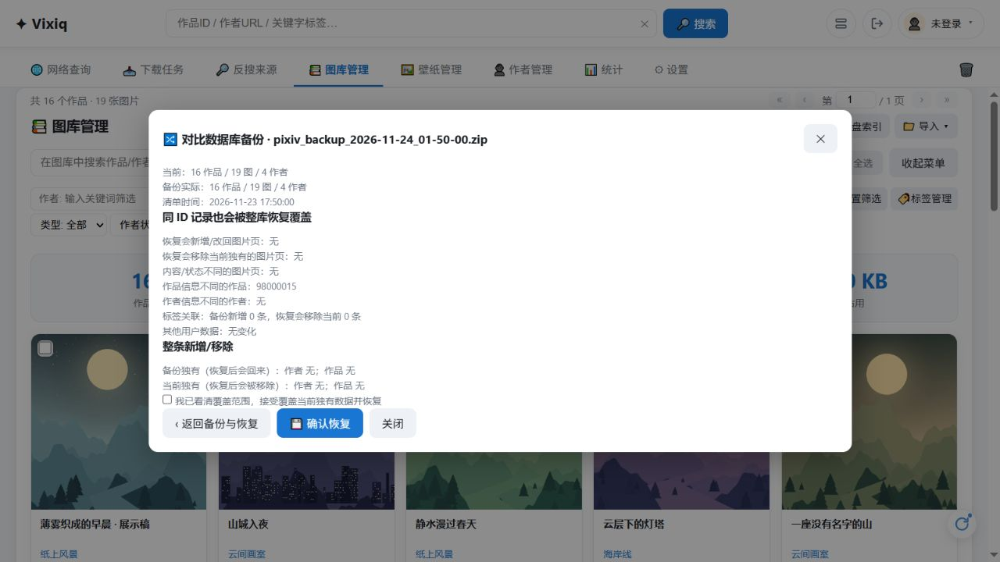

# Vixiq

**面向 Windows 的 Pixiv 下载、本地图库与壁纸管理工具。** 可以搜索作品并排队下载，也能整理已有图库、管理桌面壁纸，界面在浏览器中打开。




> 截图取自示例图库，功能介绍以当前源码为准。

数据默认保存在本地，图片这类会持续变大的数据可以指定到非系统盘。也可以打包成免安装的 exe，双击即用。

## 主要用途

- **查询、下载与找回来源**：按作品 ID、作者或关键字查询，加入下载队列后可停止与重试；用作品 ID 或 SauceNAO 反查来源，本地也支持以图搜图。
- **整理与维护本地图库**：把已有图片收进图库，用标签、筛选、批量编辑与拆分合并整理，并借助体检、备份与回收站维护。
- **桌面壁纸与窄屏浏览**：贴边壁纸小控件、壁纸夹轮播、按图库尺寸生成壁纸与托盘常驻；手机访问提供自适应布局。

## 快速开始

**方式一：下载打包版（推荐）**

到 [Releases](https://github.com/goderror/vixiq/releases) 下载 Windows 压缩包，解压后双击 `vixiq.exe`，浏览器会自动打开 `http://127.0.0.1:7790/`（7790 为默认端口）。

**方式二：从源码运行**

需要 Windows 10/11、Python 3.11 及以上、Microsoft Edge。

```bash
python -B -m venv .venv
.venv\Scripts\python.exe -m pip install -r requirements-dev.txt
.venv\Scripts\python.exe main.py
```

首次使用 Pixiv 查询与下载前，请先到「设置 → 账户」登录 Pixiv —— 这部分联网功能依赖登录态。本地图库无需登录即可浏览。

---

## 功能

| 页签 | 说明 |
|------|------|
| 🌐 网络查询 | 按作品 ID、作者 URL 或关键字搜索作品，结果可加入下载清单 |
| 📥 下载任务 | 管理下载队列与进度，支持停止、重试与动图合成 |
| 🔎 反搜来源 | 按作品 ID 直查来源，或用 SauceNAO 以图搜源 |
| 📚 图库管理 | 紧凑筛选、标签类别、批量编辑、作品合并拆分与大图预览 |
| 🖼️ 壁纸管理 | 扫描壁纸归属，按作品或分组浏览，查找重复项，可从壁纸定位到图库作品 |
| 🗑️ 回收站 | 恢复已删图片，或将删除的文件彻底清除 |
| 👤 作者管理 | 作者搜索与筛选、改名、来源链接、配对认领 |
| 📊 统计 | 来源、作者、作品类型、R18 与标签分布 |
| ⚙ 设置 | 账户、系统与启动、桌面与壁纸、浏览与下载、日志与记录、数据与路径、维护 |

**桌面层**

| 模块 | 说明 |
|------|------|
| 🖼️ 桌面小控件 | 贴边的壁纸便签，悬停展开可查看或更换壁纸 |
| 🖼️ 壁纸夹 / 壁纸库 | 指定壁纸夹作为幻灯片源，也可从图库按尺寸与比例生成壁纸 |
| ✨ 壁纸文案 AI | 为当前壁纸生成标题与一句描述 |
| 🖥 托盘常驻 | 提供托盘图标与菜单，可在设置中开关后台常驻行为 |
| 📱 手机浏览 | 自适应布局、滑动翻页、捏合缩放；开启前需先设置访问密码（可选对外连接） |
| 安全模式 | 以占位图遮盖 R18 内容 |
| 📁 路径 | 统一管理图片、数据、临时目录与壁纸夹 |
| 🎀 回到顶部 | 滚动后出现，点击回到页首 |

### 图库维护

| 功能 | 说明 |
|------|------|
| 整理文件夹 | 预览移动计划与冲突，确认后执行。本轮搬空的目录在同次操作中收尾。 |
| 智能刷新 | 先更新当前页面，需要核对时在后台运行并显示动画进度 |
| 同步磁盘与图片格式 | 核对已登记路径与磁盘，提示缺失及待确认冲突；支持待转 PNG 的预览确认；下载与导入对受支持的静态图片按规则统一为 PNG，并提供单张 PNG 转 JPG 的大小预览 |
| 图库体检 | 分组报告文件缺失、损坏、待补资料和待整理目录。修复需单独触发 |
| 备份与恢复 | 数据库备份、另存与恢复前差异预览；恢复前保留快照，旧图版本可单独切换 |

数据库 ZIP 的主要覆盖范围是图库索引与元数据，图片原件需另行备份。

### 界面截图

#### 标签管理



#### 壁纸管理



#### 恢复前差异预览



---

## 打包为 exe

```bash
.venv\Scripts\python.exe -m PyInstaller build.spec --noconfirm
```

产物位于 `dist/vixiq/`，整个目录拷走即可双击运行（windowed，无控制台）。若修改 `build.spec` 的 `datas`，需保留 `web/static` 资源的收集逻辑（按文件写入 `web/static`），否则首页返回 404。

仓库不包含 `resources/msedgedriver.exe`（二进制体积大且须与本地 Edge 版本匹配），Selenium 会按配置匹配本机驱动版本。

公开构建可设置环境变量 `$env:VIXIQ_RELEASE = '1'` 后再打包，以排除自用资源。

---

## 首次使用

1. **登录（仅限 Pixiv 查询与下载）**：设置页 →「账户」→ 登录 Pixiv 账号。登录态持久化，cookies 过期后需重新登录；本地图库无需登录即可直接浏览。
2. **配置图片目录**（可选）：设置页 →「📁 路径」，将「图片目录」指向非系统盘。
3. **查询并入队**：查询页按作品 ID / 作者 URL / 关键字搜索，卡片上点「加入清单」。
4. **下载**：下载任务页 →「▶ 开始所有未完成」。
5. **管理图库**：图库管理页筛选、排序、搜索；可点「🩺」运行体检，分组列出文件缺失、损坏、待补资料与待整理目录。
6. **桌面层**（可选）：指定壁纸夹后，在设置页「系统与启动」分组启用「🖼️ 桌面壁纸小控件」与「🖥 托盘常驻」。
7. **AI 文案**（可选）：设置页 →「✨ 壁纸文案」，填写接口地址（到 `/v1` 为止）、模型名与密钥 →「🔌 测试连接」。

---

## 数据与存储

程序本体与体积小、增长慢的数据（配置、内置资源、数据库、日志、缩略图）默认位于程序目录；图片这类体积大且持续增长的数据建议指向非系统盘。目录划分由 `utils/paths.py` 统一分发，代码中无硬编码路径。

| 设置项 | 配置键 | 内容 | 默认 |
| --- | --- | --- | --- |
| 图片目录 | `paths.img_subdir` | 图库原图（体积大且持续增长） | 数据目录下的 `img/`；可填绝对路径指向非系统盘 |
| 数据目录 | `paths.data_root_override` | 数据库 · 日志 · 缩略图 | 程序目录下的 `data/` |
| 临时目录 | `paths.temp_root_override` | 浏览器 profile · 上传缓冲（可随时清理） | 数据目录下的 `temp/` |

三项修改后重启生效。壁纸夹在「📁 路径」卡片的第四项，选完立即生效。

```
<程序目录>/
├── main.py 或 vixiq.exe       程序入口
├── resources/                 只读资源：default.json、xpaths.json、图标、启动图
├── config/user.json           本地配置（不入库）
└── web/  core/  db/  utils/   源码

<数据目录>/
├── pixiv.db                   主数据库
├── cookies.bin                登录态（DPAPI 加密）
├── img/                       图库原图
├── thumbs/                    480px 缩略图缓存（可整目录清除，会自动重建）
├── logs/                      运行日志（仅保留最近 7 天）
├── feature_db/                以图搜图特征库
└── temp/                      临时文件（含 Selenium 临时 profile）
```

**配置机制**：`config/user.json` 覆盖 `resources/default.json` 的默认值，深度合并；未声明的字段由 `utils/config.py` 的 `_canonicalize` 补齐。路径重定向通过四个字段实现：

```json
"paths": {
  "img_subdir": "D:/vixiq-img",
  "data_root_override": "D:/vixiq-data",
  "temp_root_override": "D:/vixiq-temp",
  "wallpaper_dir": "D:/vixiq-wallpapers"
}
```

`img_subdir` 填单段子目录名（如 `img`）表示置于数据目录下，填绝对路径表示使用其他磁盘。

---

## 隐私与安全

- **本地存储**：图片、数据库、特征库和日志保存在本机。
- **联网功能**：查询和下载使用 Pixiv。以图搜源时可将所选图片提交给 SauceNAO。启用壁纸文案时会向配置的服务发送壁纸。手机访问默认关闭，启用后通过 Cloudflare 快速隧道并使用访问密码。
- **安全模式**：R18 内容显示占位图，相应缩略图不会被请求。
- **登录态**：Windows 默认用 DPAPI 加密保存登录态。Cookies 过期后需重新登录。
- **不纳入版本库**：`config/user.json`、`data/`、`*.db`、`logs/` 均在 `.gitignore` 中排除。

## 缓存清理

1. **Selenium 临时 profile**：驱动退出时立即删除。
2. **临时目录**：启动时清理超过 24 小时的文件，超过 5 GB 时按旧到新删除，进程退出时再清理一次。设置页 →「📁 路径」另提供一键清理。
3. **日志**：启动时删除 `logs/` 下超过 7 天的日志。

---

## 常见问题

- **端口被占用**：默认端口 7790，可通过 `web.port` 修改。已有实例在运行时直接复用，否则改用下一个可用端口。
- **Edge driver 版本不匹配**：`resources/msedgedriver.exe` 须与本地 Edge 大版本一致。启动报错时升级 Edge，或移除该文件由 Selenium 自动下载匹配驱动。
- **「回到顶部」显示为纯色圆形**：该按钮的装饰图不在仓库中，界面显示为圆形底加白色箭头，功能不受影响。
- **数据占用系统盘**：设置页 →「📁 路径」显示各目录的实际落点与占用。将「图片目录」指向非系统盘可显著降低系统盘占用；也可直接修改 `config/user.json` 中的 `img_subdir` / `data_root_override` / `temp_root_override`。
- **修改路径未生效**：路径改动需重启 Vixiq（数据库连接与路径缓存在进程内建立）；「系统与启动」分组内的开关保存后立即生效。

---

## 开发

- **测试**：`.venv\Scripts\python.exe -m autotest.smoke_all`，报告写入 `autotest/SMOKE_REPORT.md`。
- **临时诊断脚本**：统一放在 `autotest/_live_*.py`，用后删除。
- **文档**：功能变化同步更新 README，版本级变化记入 [CHANGELOG.md](CHANGELOG.md)。

---

## 免责声明

- **非官方项目**：Vixiq 是个人开发的本地工具，与 pixiv Inc.（ピクシブ株式会社）没有任何隶属、赞助或认可关系，也不是官方客户端。
- **商标**：「Pixiv」「pixiv」为 pixiv Inc. 的商标或注册商标，本项目仅在描述用途时提及（如说明数据来源、登录对象）；项目名称「Vixiq」与图标均为原创。
- **使用范围**：仅供个人学习、研究与备份自己有权访问的内容。请遵守 [pixiv 利用規約](https://www.pixiv.co.jp/policy/) 与所在地区法律法规，不得用于批量转载、二次分发、破解付费内容或任何商业用途。
- **风险自担**：平台接口变更或风控策略调整可能导致部分功能失效甚至影响账号；使用本工具产生的后果由使用者自行承担。
- **按现状提供**：软件按「现状」提供，不附带任何明示或默示担保，包括但不限于适销性与特定用途适用性。

## 许可

[MIT License](LICENSE) © 2026 goderror
