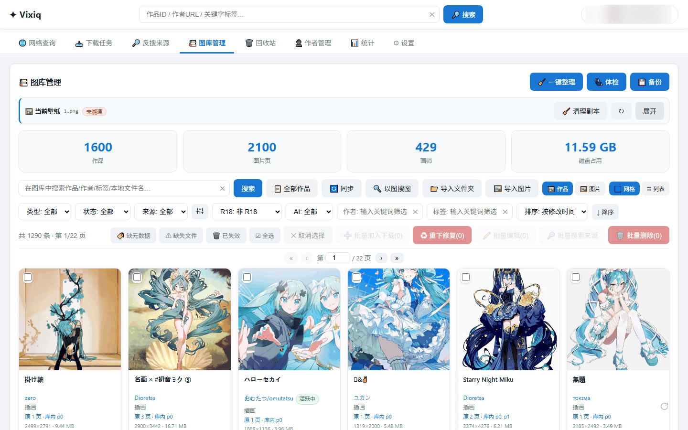
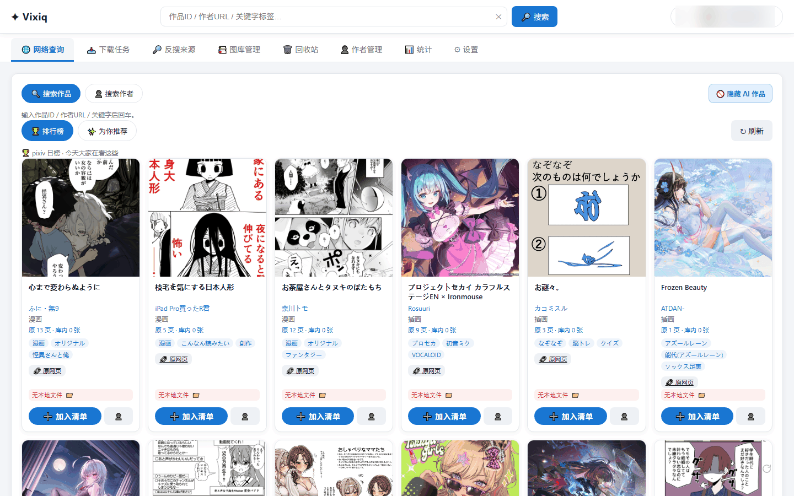
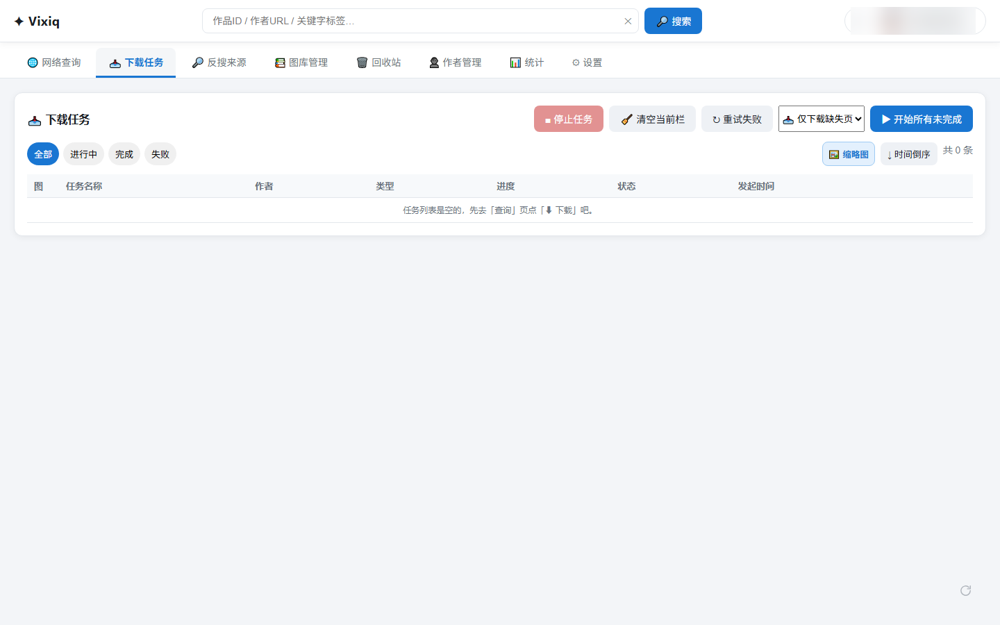
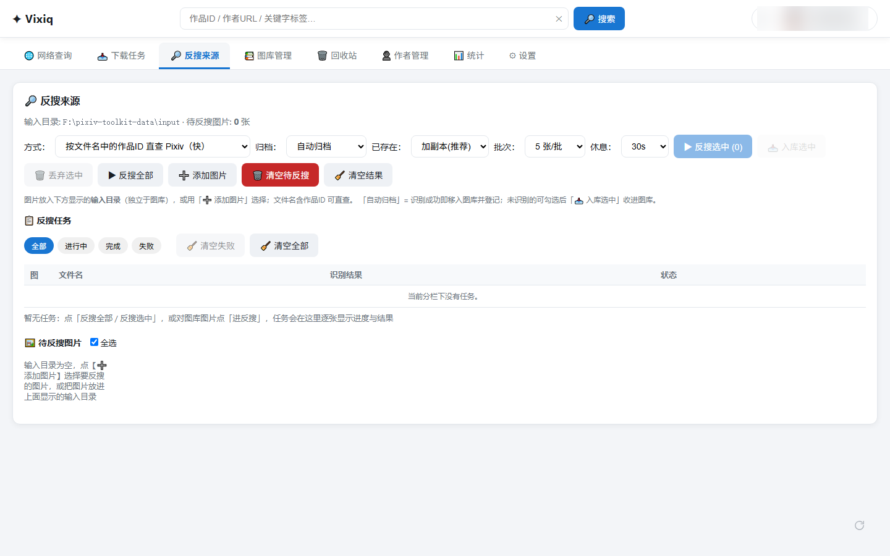
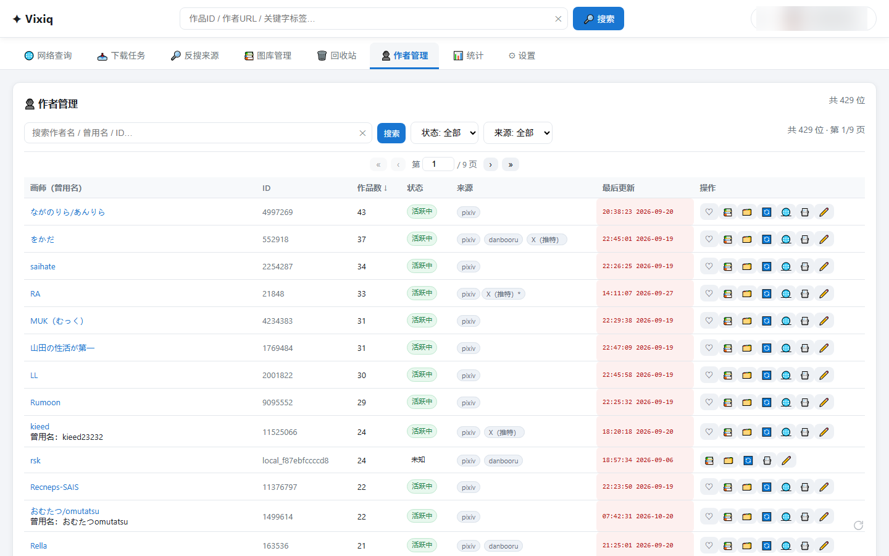
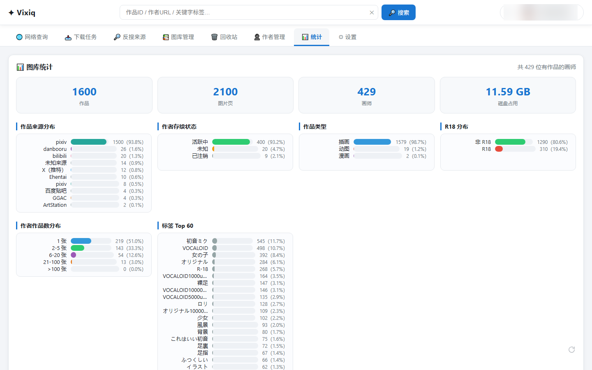
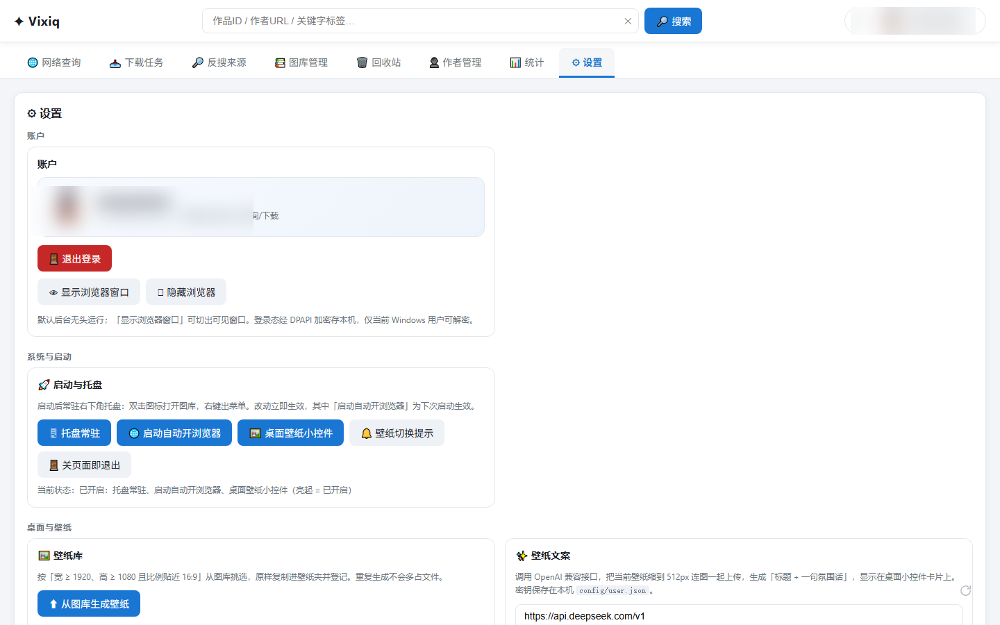
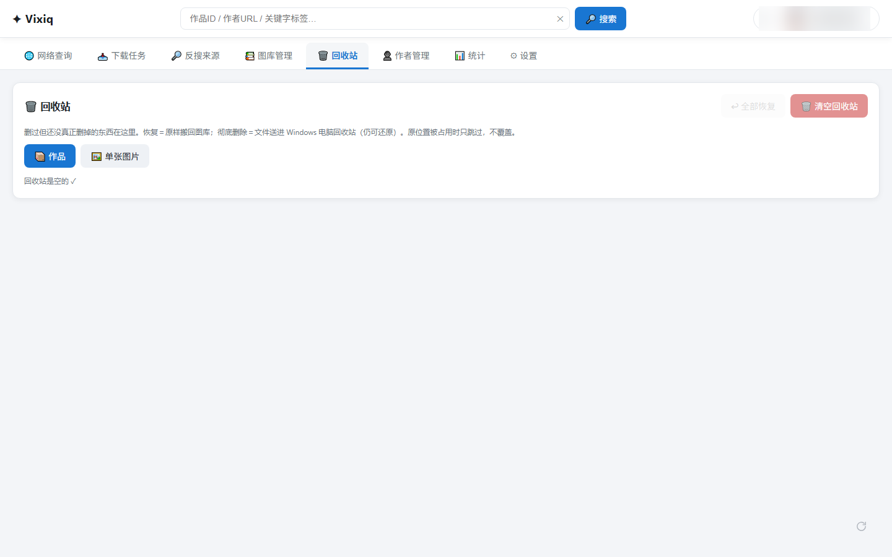

# Vixiq

**本地运行的 Pixiv 图片下载与图库管理工具。** 搜作品、批量下载、以图搜源、管理作者、整理图库，还能把收藏做成桌面壁纸轮播。


数据全部保存在本地，不经过任何中转服务器；图片这类会持续变大的数据可以指定到非系统盘。也可以打包成免安装的 exe，双击即用。



## 和常见的 Pixiv 下载脚本有什么不同

- **有界面**：网页式操作，不用记命令、不用改配置文件；下载队列可暂停、重试，动图自动合成
- **不只是下载**：图库支持标签、批量编辑、拆分合并、回收站、体检（找出缺作者或缺文件的条目）和来源统计
- **能找回来源**：按作品 ID 直查，或用 SauceNAO 以图搜源；本地也支持以图搜图，适合整理来路不明的图
- **桌面层**：贴边壁纸便签、壁纸夹轮播、按图库尺寸生成壁纸，还有托盘常驻和安全模式（对 R18 打码）
- **隐私可控**：登录态用 Windows DPAPI 加密后存本地；日志只留 7 天；临时目录超 24 小时自动清理

## 快速开始

**方式一：下载打包版（推荐）**

到 [Releases](https://github.com/goderror/vixiq/releases) 下载 `vixiq-v1.0.0-win64.zip`，解压后双击 `vixiq.exe`，浏览器会自动打开 `http://127.0.0.1:7790/`。

**方式二：从源码运行**

需要 Windows 10/11、Python 3.11 及以上、Microsoft Edge。

```bash
python -B -m venv .venv
.venv\Scripts\python.exe -m pip install -r requirements-dev.txt
.venv\Scripts\python.exe main.py
```

首次使用请先到「设置 → 账户」登录 Pixiv —— 查询和下载都依赖登录态。

---

## 功能

| 页签 | 说明 |
|------|------|
| 🌐 网络查询 | 按作品 ID、作者 URL 或关键字搜索作品，结果可加入下载清单 |
| 📥 下载任务 | 管理下载队列与进度，支持停止、重试与动图合成 |
| 🔎 反搜来源 | 按作品 ID 直查来源，或用 SauceNAO 以图搜源 |
| 📚 图库管理 | 浏览与预览、筛选排序分页；标签与批量编辑；拆分合并、以图搜图、体检 |
| 🗑️ 回收站 | 恢复已删图片，或将删除的文件彻底清除 |
| 👤 作者管理 | 作者搜索与筛选、改名、来源链接、配对认领 |
| 📊 统计 | 来源、作者、作品类型、R18 与标签分布 |
| ⚙ 设置 | 账户、系统与启动、桌面与壁纸、浏览与下载、日志与记录、数据与路径、维护 |

**桌面层**

| 模块 | 说明 |
|------|------|
| 🖼️ 桌面小控件 | 贴边的壁纸便签，悬停展开可查看或更换壁纸 |
| 🖼️ 壁纸夹 / 壁纸库 | 指定壁纸夹作为幻灯片源，也可从图库按尺寸与比例生成壁纸 |
| ✨ 壁纸文案 AI | 为当前壁纸生成标题与一句描述 |
| 🖥 托盘常驻 | 提供托盘图标与菜单，可在设置中开关后台常驻行为 |
| 安全模式 | 对 R18 内容打码，适合公共场合浏览 |
| 📁 路径 | 统一管理图片、数据、临时目录与壁纸夹 |
| 🎀 回到顶部 | 滚动后出现，点击回到页首 |

### 界面示例

<table>
<tr>
<td width="50%"><br>🌐 网络查询</td>
<td width="50%"><br>📥 下载任务</td>
</tr>
<tr>
<td><br>🔎 反搜来源</td>
<td><br>👤 作者管理</td>
</tr>
<tr>
<td><br>📊 统计</td>
<td><br>⚙ 设置</td>
</tr>
<tr>
<td><br>🗑️ 回收站</td>
<td></td>
</tr>
</table>

---

## 打包为 exe

```bash
.venv\Scripts\python.exe -m PyInstaller build.spec --noconfirm
```

产物位于 `dist/vixiq/`，整个目录拷走即可双击运行（windowed，无控制台）。若修改 `build.spec` 的 `datas`，需保留 `('web/static', 'web/static')`，否则首页返回 404。

仓库不包含 `resources/msedgedriver.exe`（二进制体积大且须与本地 Edge 版本匹配），首次运行由程序按需获取。

---

## 首次使用

1. **登录**：设置页 →「账户」→ 登录 Pixiv 账号。登录态持久化，所有联网功能依赖登录态；cookies 过期后需重新登录。
2. **配置图片目录**（可选）：设置页 →「📁 路径」，将「图片目录」指向非系统盘。
3. **查询并入队**：查询页按作品 ID / 作者 URL / 关键字搜索，卡片上点「加入清单」。
4. **下载**：下载任务页 →「▶ 开始所有未完成」。
5. **管理图库**：图库管理页筛选、排序、搜索；可点「🩺」运行体检，列出缺作者或缺失文件的条目。
6. **桌面层**（可选）：指定壁纸夹后，在设置页「系统与启动」分组启用「🖼️ 桌面壁纸小控件」与「🖥 托盘常驻」。
7. **AI 文案**（可选）：设置页 →「✨ 壁纸文案」，填写接口地址（到 `/v1` 为止）、模型名与密钥 →「🔌 测试连接」。

---

## 数据与存储

程序本体与体积小、增长慢的数据（配置、内置资源、数据库、日志、缩略图）默认位于程序目录；图片这类体积大且持续增长的数据建议指向非系统盘。目录划分由 `utils/paths.py` 统一分发，代码中无硬编码路径。

| 设置项 | 配置键 | 内容 | 默认 |
| --- | --- | --- | --- |
| 图片目录 | `paths.img_subdir` | 图库原图（体积大且持续增长） | 数据目录下的 `img/`；可填绝对路径指向非系统盘 |
| 数据目录 | `paths.data_root_override` | 数据库 · 日志 · 缩略图 | 程序目录下的 `data/` |
| 临时目录 | `paths.temp_root_override` | 浏览器 profile · 上传缓冲（可随时清理） | 数据目录下的 `temp/` |

三项修改后重启生效。壁纸夹在「📁 路径」卡片的第四项，选完立即生效。

```
<程序目录>/
├── main.py 或 vixiq.exe       程序入口
├── resources/                 只读资源：default.json、xpaths.json、图标、启动图
├── config/user.json           本地配置（不入库）
└── web/  core/  db/  utils/   源码

<数据目录>/
├── pixiv.db                   主数据库
├── cookies.bin                登录态（DPAPI 加密）
├── img/                       图库原图
├── thumbs/                    480px 缩略图缓存（可整目录清除，会自动重建）
├── logs/                      运行日志（仅保留最近 7 天）
├── feature_db/                以图搜图特征库
└── temp/                      临时文件（含 Selenium 临时 profile）
```

**配置机制**：`config/user.json` 覆盖 `resources/default.json` 的默认值，深度合并；未声明的字段由 `utils/config.py` 的 `_canonicalize` 补齐。路径重定向通过四个字段实现：

```json
"paths": {
  "img_subdir": "D:/vixiq-img",
  "data_root_override": "D:/vixiq-data",
  "temp_root_override": "D:/vixiq-temp",
  "wallpaper_dir": "D:/vixiq-wallpapers"
}
```

`img_subdir` 填单段子目录名（如 `img`）表示置于数据目录下，填绝对路径表示使用其他磁盘。

---

## 隐私与安全

- **本地处理**：图片、特征库、登录态、数据库、日志仅保存在本地。
- **外部接口**：仅「壁纸文案 AI」会按填写的配置把当前壁纸发送到对应服务商，未配置时不产生外部请求。
- **Cookies 加密**：登录态写入 `cookies.bin`，使用 Windows DPAPI（AES-256，密钥由系统按当前账户托管）加密，并加文件 ACL 锁定。更换系统或修改密码后旧 cookies 无法解密，重新登录即可。
- **不纳入版本库**：`config/user.json`、`data/`、`*.db`、`logs/` 均在 `.gitignore` 中排除。

## 缓存清理

1. **Selenium 临时 profile**：驱动退出时立即删除。
2. **临时目录**：启动时清理超过 24 小时的文件，超过 5 GB 时按旧到新删除，进程退出时再清理一次。设置页 →「📁 路径」另提供一键清理。
3. **日志**：启动时删除 `logs/` 下超过 7 天的日志。

---

## 常见问题

- **端口被占用**：默认端口 7790，可通过 `web.port` 修改。已有实例在运行时直接复用，否则改用下一个可用端口。
- **Edge driver 版本不匹配**：`resources/msedgedriver.exe` 须与本地 Edge 大版本一致。启动报错时升级 Edge，或移除该文件由 Selenium 自动下载匹配驱动。
- **「回到顶部」显示为纯色圆形**：该按钮的装饰图不在仓库中，界面显示为圆形底加白色箭头，功能不受影响。
- **数据占用系统盘**：设置页 →「📁 路径」显示各目录的实际落点与占用。将「图片目录」指向非系统盘可显著降低系统盘占用；也可直接修改 `config/user.json` 中的 `img_subdir` / `data_root_override` / `temp_root_override`。
- **修改路径未生效**：路径改动需重启 Vixiq（数据库连接与路径缓存在进程内建立）；「系统与启动」分组内的开关保存后立即生效。

---

## 开发

- **测试**：`.venv\Scripts\python.exe -m autotest.smoke_all`（T1~T136，128 用例，全程离线，约 48 秒），报告写入 `autotest/SMOKE_REPORT.md`。
- **临时诊断脚本**：统一放在 `autotest/_live_*.py`，用后删除。
- **文档**：功能变化同步更新 README，版本级变化记入 [CHANGELOG.md](CHANGELOG.md)。

---

## 免责声明

- **非官方项目**：Vixiq 是个人开发的本地工具，与 pixiv Inc.（ピクシブ株式会社）没有任何隶属、赞助或认可关系，也不是官方客户端。
- **商标**：「Pixiv」「pixiv」为 pixiv Inc. 的商标或注册商标，本项目仅在描述用途时提及（如说明数据来源、登录对象）；项目名称「Vixiq」与图标均为原创。
- **使用范围**：仅供个人学习、研究与备份自己有权访问的内容。请遵守 [pixiv 利用規約](https://www.pixiv.co.jp/policy/) 与所在地区法律法规，不得用于批量转载、二次分发、破解付费内容或任何商业用途。
- **风险自担**：平台接口变更或风控策略调整可能导致部分功能失效甚至影响账号；使用本工具产生的后果由使用者自行承担。
- **按现状提供**：软件按「现状」提供，不附带任何明示或默示担保，包括但不限于适销性与特定用途适用性。

## 许可

[MIT License](LICENSE) © 2026 goderror
